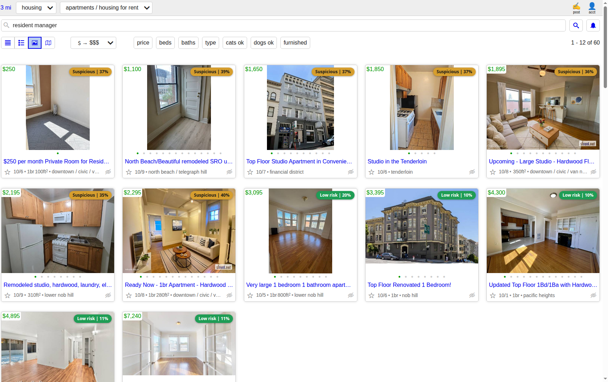
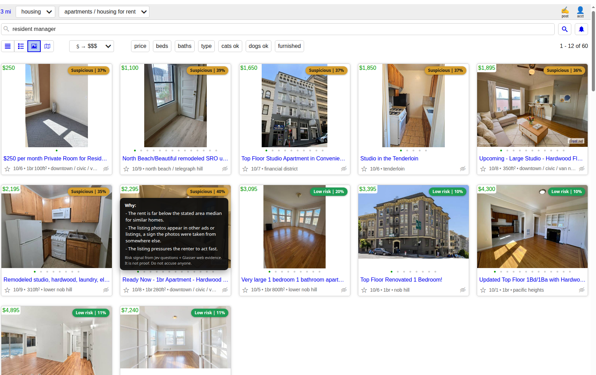
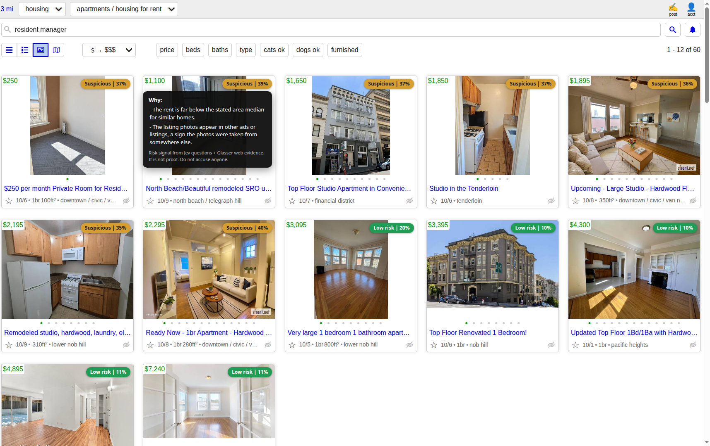
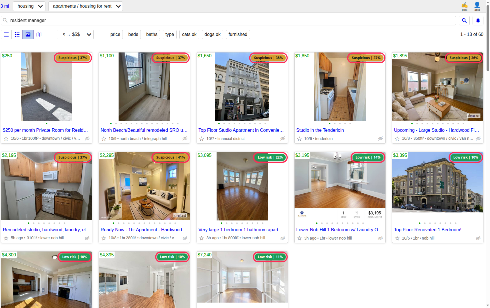
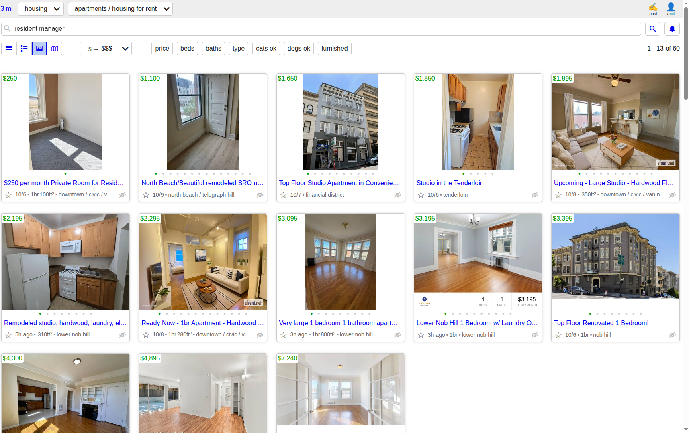
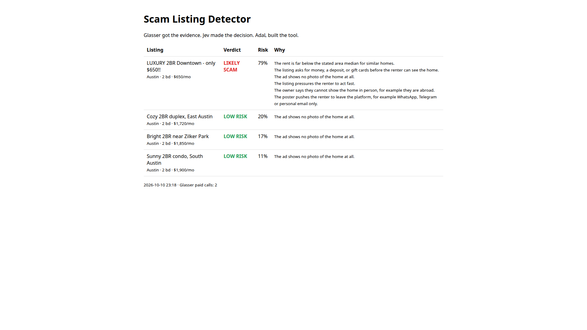
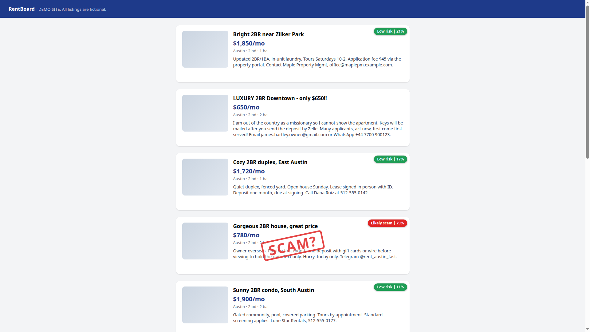

# Scam Listing Detector

A Chrome extension that labels rental listings while you scroll, so the warning signs are on the card before you get attached to the photos. Built at the **What Would Jev Do?** hackathon with **AdaL**, **Glasser** and **Jev**.

[▶ Watch the 63 second demo](media/demo.mp4)



## Screenshots

Hovering a badge opens the reasons, and the reasons come from Jev's answers plus the evidence Glasser fetched.

| A listing with three reasons | A second one with two |
|---|---|
|  |  |

| Every badge outlined, so you know where to look | The same page with no extension loaded |
|---|---|
|  |  |

| The command line report | The built-in demo page |
|---|---|
|  |  |

---

Rental listings, scored as you read them: **LOW RISK**, **SUSPICIOUS**, or **LIKELY SCAM**.

Two ways to run it:

- **Browser extension** — labels listings in place while you browse.
- **Command line** — scores a JSON file of listings into an HTML report.

### What the labels mean

| Label | Risk | Meaning |
|---|---|---|
| **Low risk** | under 30% | No strong red flags found. This is **not** a promise the listing is genuine. |
| **Suspicious** | 30-54% | At least one real warning sign. Read the "Why" list. |
| **Likely scam** | 55% and up | Several strong signs together. |

Each flag adds only a few points, so a listing can show a mild flag and still be **Low risk**. For example, "presses you to act fast" (8 points) plus "no photo" (3 points) comes to 11, well under the 30% line. The badge names the risk band, not a verdict on a person. That is why the old label said "Looks real" and confused people: it sounded like a clean bill of health.

---

## The Three Tools

| Tool | Job |
|---|---|
| **Jev** | Answers eleven yes/no questions about each listing. Fast, typed, calibrated. |
| **Glasser** | Brings outside evidence: web search, address lookups, photos, property records. Pay per call. |
| **AdaL** | Built this project. Also records the demo video. |

---

## How It Works

1. Read a listing.
2. **Cheap pass.** Jev answers the eleven questions from the listing text alone. A free Glasser address lookup runs too, because pdl costs nothing.
3. **Paid pass**, only if the first pass is already a little worrying (risk >= 25%):
   - web search on the contact,
   - reverse image search on the listing photo (Google Lens),
   - public property records for the address,
   - exact-phrase search for the same listing in other cities,
   - a Google Maps confirmation of the address.
4. **Jev answers again**, now with that evidence in front of it.
5. **Our code** combines the answers with fixed weights into one risk score.

### The eleven questions

| Question | Weight |
|---|---|
| Rent far below the page median? | 0.26 |
| Money or deposit before viewing? | 0.20 |
| Pushes you off-platform (WhatsApp, personal email)? | 0.12 |
| Owner cannot show the home in person? | 0.10 |
| Pressure to act fast? | 0.08 |
| Address resolves to another city or state? | 0.07 |
| Web evidence reports it as a scam? | 0.06 |
| Photos appear in other ads? | 0.04 |
| No photo in the ad at all? | 0.03 |
| Property records show a different owner? | 0.02 |
| Same listing in several cities at once? | 0.02 |

The weights sum to 1. Change them in `extension/lib/core.js`.

Why eleven small questions? Jev works best on small, single-purpose questions, and keeping the weighing in our own code makes it easy to read and tune.

---

## Quick Start — browser extension

1. `pip install -r requirements.txt`, then set up `.env` (see `.env.example`).
2. `node relay/server.js` — the relay holds the API keys, so the extension never sees them.
3. `chrome://extensions` -> Developer mode -> **Load unpacked** -> pick `extension/`.
4. Browse Craigslist, Zillow, Apartments.com, Trulia, Redfin, Zumper, Hotpads or Facebook Marketplace. Badges appear as cards scroll into view.
5. Try the built-in demo page: http://127.0.0.1:8790/demo

## Quick Start — command line

```
python main.py scan --mock          # offline demo, no keys, no cost
python main.py scan --no-glasser    # real Jev, no Glasser spend
python main.py scan                 # full flow, asks before spending
```

Open `out/report.html`.

---

## Commands

| Command | Cost | What it does |
|---|---|---|
| `python main.py discover` | Free | Finds Glasser endpoints and prices |
| `python main.py scan --mock` | Free | Offline keyword rules. **Not real Jev.** |
| `python main.py scan --no-glasser` | Jev only | Real Jev, no Glasser |
| `python main.py scan` | Glasser + Jev | Full flow. Asks before spending |
| `npm test` | Free | Runs the extension and relay tests |
| `python -m pytest -q` | Free | Runs the CLI tests |

---

## Files

```
extension/                   browser extension
  manifest.json              allowed sites and permissions
  background.js              calls the relay, since an https page cannot reach localhost
  content.js                 finds cards, draws the badge, reads the photo
  content.css                badge and stamp styling
  popup.html, popup.js       toolbar popup: shows relay health
  lib/core.js                questions, weights, verdict (shared with the relay)
  lib/sites.js               where the cards are on each site
relay/                       local server: holds the keys
  server.js                  HTTP endpoints and payload checks
  score.js                   the two-pass flow and every Glasser call
demo/listings.html           fake listing page for demos and videos
main.py                      command line entry (loads .env itself)
scam_detector/               CLI: glasser_client, jev_client, detector, report
data/sample_listings.json    3 real-looking, 3 scam-like (fictional)
test/                        relay and scoring tests (node --test)
tests/                       CLI tests (pytest)
recording/                   real-Chrome check that screenshots the demo page
out/                         generated: report.html and screenshots
package.json                 relay and test scripts
README.md                    this file
EXTENSION.md                 extension guide, sites, datasets
PLAN.md                      what you need to do
VIDEO_SCRIPT.md              demo video outline
```

---

## What it costs

| Check | Price |
|---|---|
| Address canonicalisation (pdl) | free |
| Exact-phrase duplicate search (Serper) | ~$0.0003 |
| Google Maps confirmation (Serper) | $0.0033 |
| Reverse image search (SerpApi Google Lens) | $0.015 |
| Property records (RentCast) | $0.0814 |

The free address check runs on every listing. Everything paid waits until the first pass is already worrying, and repeat lookups are cached.

---

## Honest Limits

- The sample listings are **fictional**.
- A verdict is a **risk signal, not proof**. Never accuse a real person. **"Low risk" means no strong red flags were found, not that the listing was verified.**
- The page median needs at least five priced listings. Below that we pass "unknown" and Jev falls back on its own sense of the local market.
- A missing photo is a mild signal, not proof: plenty of genuine room-share ads have none.
- An address mismatch is not always fraud: agencies list their own office address.
- Property records cover the **US** only, and only where RentCast has data.
- The photo check needs a photo. Craigslist text-only ads skip that step.
- Reverse image search finds *similar* images, not proof of theft.
- An exact phrase showing up in two cities is suspicious, not conclusive.
- Glasser prices change. Always read the price before running.
- Jev only answers the questions it is given. Weak evidence gives weak answers.

---

## Next Steps

- **Ownership, done properly.** We fetch the property record; comparing the recorded owner's name against the poster automatically would make that check much stronger.
- **Phone reputation.** Burner and VoIP detection, plus how long the email domain has existed.
- **Cross-listing graph.** Cluster listings that share a phone number, a photo or the same text, and score the cluster instead of the single listing.
- **Perceptual hashing.** Match photos by content rather than by a URL lookup.
- **More sites.** Each new site needs an allow-list entry and a card selector.
